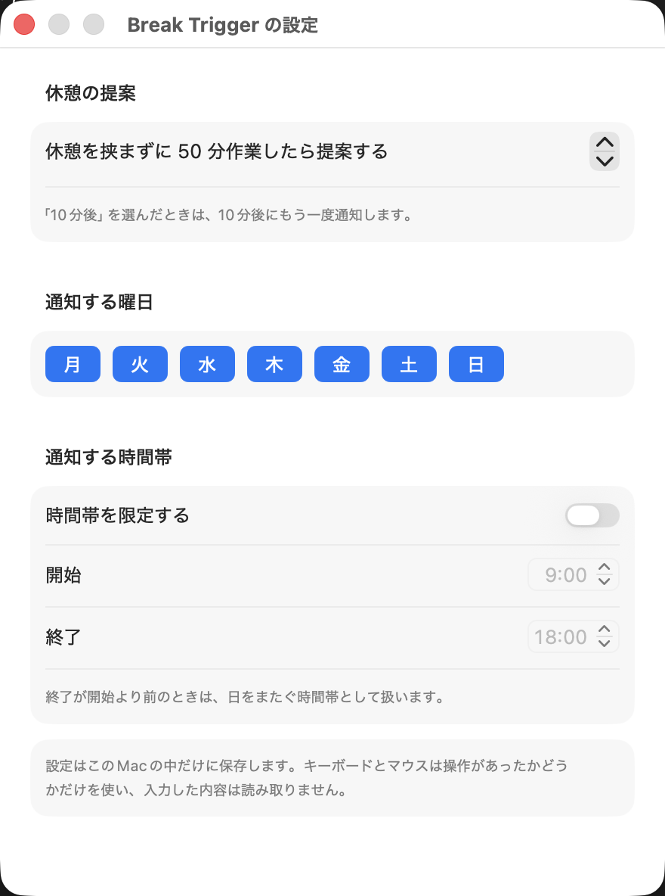

# Break Trigger

長時間の作業で休憩を取り逃さないための、macOSのメニューバーアプリ。作業が一段落したところで休憩を提案し、まだ手を止めたくないときは、通知から「10分後」を選ぶだけでもう一度知らせる。

Macで集中して作業する人、とくに考えごとやコードを読む時間が長く、休憩のタイミングを逃しやすい人に向けている。

## 動作環境

- macOS 13以降
- Xcode（Swift 6以降）。ビルドに使う

## インストール

配布用のアプリはまだない。手元でビルドして使う。

```bash
git clone https://github.com/knk1313/break-trigger.git
cd break-trigger
./scripts/build-app.sh
cp -R "build/Break Trigger.app" /Applications/
open "/Applications/Break Trigger.app"
```

通知はアプリのバンドルからしか出せないため、`swift run`ではなく上のスクリプトでアプリを作る。

ログインのたびに起動したいときは、システム設定の「一般」→「ログイン項目」にBreak Triggerを追加する。

## 通知の許可

1. 初めて起動すると、通知の許可を求めるダイアログが出るので「許可」を選ぶ。
2. 許可していないと、メニューバーのアイコンが警告の印になる。メニューの「通知の設定を開く…」から、システム設定の「通知」→「Break Trigger」で通知を許可する。
3. 通知のスタイルを「持続的」（macOS 14以前は「通知パネル」）にすると、通知が自動で消えず、選択肢のボタンが常に見える。「バナー」のままだと、通知にポインタを載せて「オプション」から選ぶ。

## 使い方

起動すると、メニューバーにアイコンが出る。あとは、いつもどおり作業するだけでよい。

### 作業時間の数え方

- キーボードとマウスの操作の有無から、最後の休憩からの作業時間を数える。5分未満の無操作は、考えごとやコードを読む時間として作業時間に含める。
- 休憩を挟まずに設定時間（初期値50分）に達したら、操作が3秒途切れたところで通知する。操作が続く間は通知を待ち、メニューバーのアイコンをカップに変えて知らせる。
- 5分以上の無操作か、Macのスリープを休憩とみなし、作業時間をリセットする。次の操作から計測を再開する。

### 通知の選択肢

| 選択肢 | 動作 |
| --- | --- |
| 今休む | 作業時間をリセットし、次の操作から計測を再開する |
| 10分後 | 選んだ時刻の10分後に再通知する。再通知でも同じ選択肢を選べる |
| 今回はスキップ | 今回の提案を閉じ、その時点から次の間隔を数える。通知を閉じたときも同じ扱い |

再通知の予約は、次のときに取り消す。

- 5分以上の無操作か、スリープがあったとき
- 再通知の時刻が、通知しない曜日・時間帯に入るとき

### メニューバーと設定

メニューバーのアイコンをクリックすると、作業時間と、再通知を予約しているときはその予定時刻が見える。提案中は、通知と同じ3つの選択肢もメニューから選べる。

「設定…」では、休憩を提案するまでの作業時間と、通知する曜日・時間帯を変えられる。「10分後」の長さは10分に固定している。



## プライバシー

- キーボードとマウスは、最後の入力からの秒数だけを読む。入力した内容は読まない。そのため、「入力監視」と「アクセシビリティ」の許可は要らない。
- 設定はUserDefaults（このMacの中）だけに保存する。ネットワークには接続しない。

## 開発

```bash
swift test                # 判定ロジックのテスト
./scripts/build-app.sh    # アプリを作る

# 時間を60分の1に縮めて起動する（50分→50秒、5分→5秒、10分→10秒。切れ目の3秒はそのまま）
BREAK_TRIGGER_TIME_SCALE=60 "build/Break Trigger.app/Contents/MacOS/BreakTrigger"
```

- `Sources/BreakTriggerCore/`：作業時間の計測と、通知・再通知・取り消しの判定。時刻と無操作の秒数を受け取るだけで、OSに依存しない
- `Sources/BreakTrigger/`：メニューバー、通知、設定画面、操作とスリープの検知
- `Tests/BreakTriggerCoreTests/`：時刻を1秒ずつ進めて、一連の操作をまねるテスト

不具合の報告や変更の提案は、[CONTRIBUTING.md](CONTRIBUTING.md)を参照。

## ライセンス

[MIT License](LICENSE)
